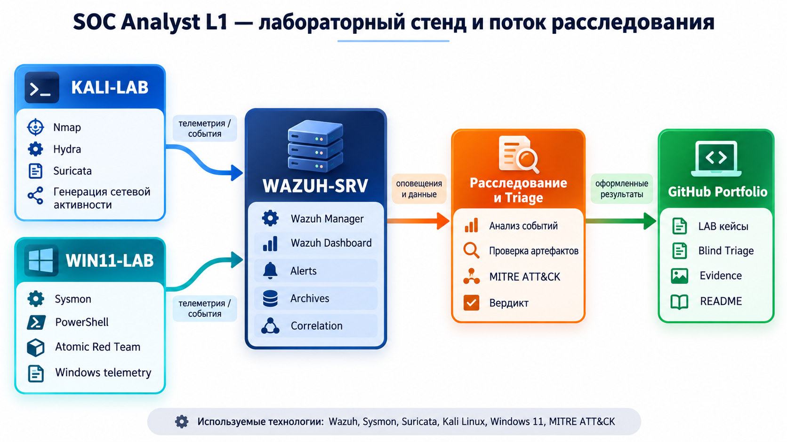

# Портфолио SOC Analyst

Учебные расследования событий информационной безопасности: от анализа оповещений и восстановления дерева процессов до формирования обоснованного вердикта, оценки критичности и выявления пробелов в обнаружении угроз.

## Лабораторная инфраструктура и процесс расследования

Схема обобщённо показывает компоненты Wazuh-лаборатории и путь от лабораторной активности до оформленного отчёта: генерация событий на тестовых узлах, сбор и корреляция в Wazuh, расследование и публикация результатов. Схема не является точной сетевой топологией: состав узлов и адресация различаются между кейсами и приведены в разделе «Среда» каждого отчёта в `labs/`. Blind SOC Investigations в `investigations/` выполнены по отдельному синтетическому датасету и не получают события из Wazuh-лаборатории.

## Подход к расследованию

1. Определить источник сигнала, затронутый узел, пользователя и временной интервал.
2. Проверить исходные события и качество доступной телеметрии.
3. Восстановить дерево процессов и последовательность действий.
4. Выявить признаки атаки (IOA) и сопоставить подтверждённые действия с MITRE ATT&CK.
5. Проверить альтернативные объяснения, включая легитимное администрирование.
6. Сформулировать итоговый вердикт, оценить критичность, зафиксировать существенные ограничения и рекомендации по реагированию.
7. Выявить пробелы в обнаружении или телеметрии и предложить способы улучшения мониторинга.

## Лабораторные кейсы

Санкционированные эксперименты в собственной лабораторной среде, а не реальные инциденты.

| Кейс | Задача | Статус |
| --- | --- | --- |
| [LAB-01 — PowerShell](labs/case-01-powershell/README.md) | Анализ подозрительного выполнения PowerShell, выявление пробела в обнаружении, разработка и проверка собственного правила Wazuh | Завершён |
| [LAB-02 — Scheduled Task Persistence](labs/case-02-scheduled-task/README.md) | Расследование создания задач OnLogon и OnStartup, устранение пробела в телеметрии и проверка обнаружения в Wazuh | Завершён |
| [LAB-03 — Network Reconnaissance](labs/case-03-network-reconnaissance/README.md) | Анализ сканирования TCP-портов и активности Nmap NSE по журналам Suricata, Wazuh, Sysmon и Windows Firewall | Завершён |
| [LAB-04 — SSH Brute Force](labs/case-04-ssh-bruteforce/README.md) | Проверка обнаружения подбора SSH-пароля, корреляция событий Wazuh и анализ контрольных входов | Завершён |

## Blind SOC Investigations

**Hands-on Labs** (`labs/`) — лабораторные эксперименты: активность генерируется в собственной среде и затем анализируется средствами обнаружения. **Blind SOC Investigations** (`investigations/`) — разбор сценариев, эталонный ответ которых на момент анализа неизвестен.

Три Blind Triage выполнены по публичному синтетическому датасету. Данные не относятся ни к реальным корпоративным инцидентам, ни к Wazuh-лаборатории из `labs/`. [Источник, методика и ограничения](investigations/README.md).

| Кейс | Сценарий | Навыки |
| --- | --- | --- |
| [TRIAGE-01](investigations/TRIAGE-01-mass-file-modification/README.md) | Mass File Modification | Анализ ложных срабатываний, анализ процессов |
| [TRIAGE-02](investigations/TRIAGE-02-password-spraying/README.md) | Password Spraying | Анализ аутентификации, первичный разбор инцидента |
| [TRIAGE-03](investigations/TRIAGE-03-oauth-consent/README.md) | OAuth Consent Abuse | Безопасность облачных сервисов, OAuth-разрешения, оценка рисков |

## Структура репозитория

`labs/` содержит лабораторные кейсы, где сценарий атаки известен заранее, `investigations/` — Blind Triage по синтетическому датасету. Каждый кейс находится в отдельной подпапке. Структура лабораторного кейса:

- `README.md` — отчёт: общие сведения, среда, дерево процессов, хронология событий, IOA, MITRE ATT&CK, вердикт и критичность, пробел в обнаружении или телеметрии;
- `evidence/` — исходные журналы, вывод инструментов и JSON событий и оповещений из Wazuh;
- `screenshots/` — скриншоты Wazuh Dashboard;
- `detection/` — собственные правила Wazuh, если они разрабатывались (сейчас только в LAB-01).
