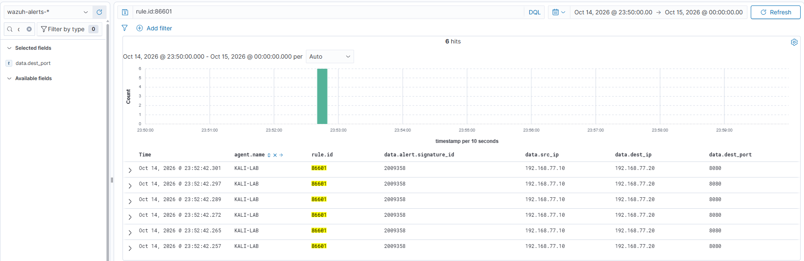
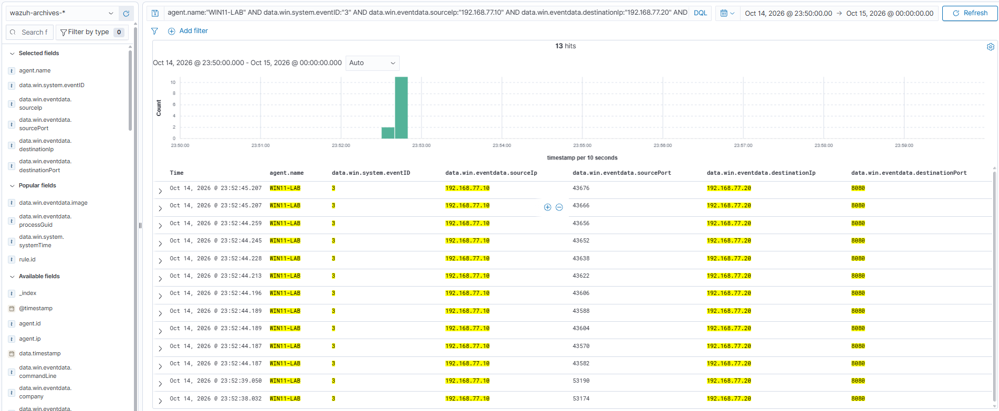

# LAB-03 — Network Reconnaissance

## Общие сведения

**Статус:** Завершён.

Исследована тестовая сетевая активность с `KALI-LAB` (`192.168.77.10`) в сторону `WIN11-LAB` (`192.168.77.20`). При TCP SYN Scan диапазона 1–1000 Nmap определил все порты как `filtered (no-response)`. На Windows зафиксированы 1000 событий блокировки TCP-пакетов на этих портах.

На отдельном этапе Suricata обнаружила HTTP-запросы с User-Agent Nmap Scripting Engine к TCP-порту `8080`: 6 IDS-оповещений и 6 соответствующих оповещений Wazuh. Sysmon на Windows зарегистрировал 13 событий сетевых соединений от Kali к этому порту. Это разные этапы лабораторной активности, а не один запуск Nmap.

**Вердикт:** True Positive — Authorized Attack Simulation. **Критичность:** Low.

## Лабораторная среда

В лаборатории использовались три виртуальные машины VirtualBox:

| Узел | Роль | Адрес тестовой сети |
| --- | --- | --- |
| Kali Linux, `KALI-LAB` | Nmap, Suricata с правилами Emerging Threats Open, Wazuh Agent | `192.168.77.10` |
| Windows 11, `WIN11-LAB` | Целевой хост, Sysmon, аудит блокировок Windows Firewall | `192.168.77.20` |
| Ubuntu | Wazuh Manager и Dashboard | Не указан в материалах кейса |

Suricata передавала события через Wazuh Agent в Wazuh Manager. Размещение IDS на той же Kali, которая генерировала тестовую активность, — упрощение учебной инфраструктуры; отдельный сетевой сенсор здесь не использовался.

## Цель и ход расследования

Цель — определить, что подтверждают вывод Nmap, сетевые оповещения IDS и журналы целевого Windows-хоста, и проверить доставку обнаружений Suricata в SIEM.

1. Проверен исходный вывод TCP SYN Scan и результат для диапазона 1–1000.
2. События Windows Security Event ID 5152 сгруппированы по эпизодам и портам назначения.
3. Для отдельного этапа NSE проверены сигнатура Suricata, адреса, порт назначения и HTTP User-Agent.
4. Проверены поступление этих обнаружений в Wazuh и наличие сетевой телеметрии Sysmon на целевом хосте.

## Этап 1 — TCP SYN Scan

Команда зафиксирована в [оригинальном выводе Nmap](evidence/01-nmap-output.txt):

```bash
nmap -sS -Pn -n -p 1-1000 --max-rate 50 --max-retries 0 --reason -oN /home/kali/case03-nmap-1000.txt 192.168.77.20
```

`-sS` задаёт TCP SYN Scan, `-p 1-1000` — исследованный диапазон, `--max-retries 0` отключает повторные попытки. В выводе указаны `1000 filtered tcp ports (no-response)` и предупреждение о достижении лимита повторных попыток.

**Факт:** Nmap не получил ответы, позволяющие определить эти порты как открытые или закрытые. Журнал Windows Security содержит эпизод из 1000 блокировок пакетов от `192.168.77.10` к `192.168.77.20`, по одной на каждый порт 1–1000, что согласуется с результатом сканирования.

В том же файле [05-firewall-5152.jsonl](evidence/05-firewall-5152.jsonl) есть другой эпизод: 60 блокировок на 30 различных портах в диапазоне 1–30. Он рассматривается отдельно; команда, вызвавшая эти блокировки, не приложена.

| Эпизод | Источник | Количество | Порты назначения | Что подтверждено |
| --- | --- | --- | --- | --- |
| TCP SYN Scan 1–1000 | Вывод Nmap | 1000 проверенных портов | TCP 1–1000 | Все порты определены как `filtered (no-response)` |
| Блокировки этапа 1–1000 | Windows Security Event ID 5152 | 1000 событий | 1000 различных портов | Windows Filtering Platform заблокировала пакеты |
| Отдельный эпизод | Windows Security Event ID 5152 | 60 событий | 30 различных портов, 1–30 | Дополнительная серия блокировок |

`filtered` не означает `closed`: по этому результату нельзя установить отсутствие служб на целевом хосте. Всего в файле Firewall 1060 записей Event ID 5152, у всех протокол `6` (TCP) и указанная пара адресов.

## Этап 2 — обнаружение Nmap NSE

В [исходных событиях Suricata](evidence/02-suricata-alerts.jsonl) присутствуют 6 оповещений с SID `2009358` и сигнатурой `ET SCAN Nmap Scripting Engine User-Agent Detected (Nmap Scripting Engine)`.

Во всех шести записях направление — `192.168.77.10 → 192.168.77.20:8080`, протокол — TCP, прикладной протокол — HTTP. Поле `http_user_agent` содержит:

```text
Mozilla/5.0 (compatible; Nmap Scripting Engine; https://nmap.org/book/nse.html)
```

**Факт:** IDS обнаружила признак NSE в HTTP-запросах. Поле `alert.action` имеет значение `allowed`; эти оповещения не подтверждают блокировку трафика Suricata. Точная команда запуска NSE в доказательствах отсутствует и не восстанавливается по предположению.

[События Wazuh](evidence/03-wazuh-suricata-alerts.jsonl) содержат 6 оповещений агента `KALI-LAB` с `rule.id: 86601`, Level 3 и `data.alert.signature_id: 2009358`. Адреса и порт назначения совпадают с исходными IDS-событиями.



### Сетевая телеметрия Windows

[04-sysmon-eid3.jsonl](evidence/04-sysmon-eid3.jsonl) содержит 13 событий Sysmon Event ID 3 с адресами `192.168.77.10 → 192.168.77.20` и портом назначения `8080`. Скриншот Discover показывает эти записи в `wazuh-archives-*` на агенте `WIN11-LAB`.



Эта телеметрия подтверждает сетевые соединения на целевом хосте. Сам по себе Event ID 3 не определяет Nmap и не содержит доказательства эксплуатации. Количество событий Sysmon и IDS различается: это разные источники и единицы учёта. Соответствие «одно оповещение — одно соединение» здесь не устанавливается.

## Ключевые события и правила

| Идентификатор | Значение | Результат в кейсе |
| --- | --- | --- |
| Suricata SID `2009358` | Идентификатор сигнатуры Emerging Threats, обнаружившей User-Agent Nmap NSE | 6 IDS-оповещений на TCP 8080 |
| Wazuh Rule ID `86601` | Правило обработки обнаружений Suricata в SIEM; конкретная сигнатура сохранена в полях оповещения | 6 оповещений, Level 3, агент `KALI-LAB` |
| Sysmon Event ID `3` | Событие сетевого соединения с адресами, портами и контекстом процесса | 13 записей на Windows для TCP 8080 |
| Windows Security Event ID `5152` | Windows Filtering Platform заблокировала пакет | 1060 записей в двух отдельных эпизодах |

Назначение Event ID сверено с документацией Microsoft: [Sysmon Event ID 3](https://learn.microsoft.com/en-us/sysinternals/downloads/sysmon#event-id-3-network-connection) и [Windows Security Event ID 5152](https://learn.microsoft.com/en-us/previous-versions/windows/it-pro/windows-10/security/threat-protection/auditing/event-5152).

## Индикаторы атаки (IOA)

1. Обращения одного источника к множеству TCP-портов одного Windows-хоста.
2. Серия блокировок пакетов на портах 1–1000, согласующаяся с TCP SYN Scan.
3. HTTP User-Agent Nmap Scripting Engine в запросах к TCP 8080 и срабатывание SID `2009358`.

Признаки описывают сетевую разведку в известном лабораторном контексте. User-Agent можно изменить или подставить, поэтому вне этого контекста одной сигнатуры недостаточно для уверенного определения инструмента.

## Сопоставление с MITRE ATT&CK

| Техника | Тактика | Основание |
| --- | --- | --- |
| [T1046 — Network Service Discovery](https://attack.mitre.org/techniques/T1046/) | Discovery | Исследование TCP-портов Windows-хоста из внутренней лабораторной сети и отдельные обращения NSE к HTTP-службе |

Соответствие проверено по описанию техники MITRE ATT&CK. Обнаружение NSE User-Agent само по себе не подтверждает поиск конкретной уязвимости, эксплуатацию или другие техники атаки; дополнительные техники не назначены.

## Вердикт

**Вердикт:** True Positive — Authorized Attack Simulation.

**Критичность:** Low — санкционированная лабораторная активность.

Подтверждена санкционированная сетевая разведка в лаборатории: сканирование TCP-портов и отдельная активность NSE. Блокировки Windows подтверждают фильтрацию пакетов на этапе SYN Scan. На другом этапе Suricata обнаружила характерный HTTP User-Agent, Wazuh принял эти оповещения, а Sysmon дополнил картину сетевыми событиями на Windows.

TCP 8080 не входит в диапазон 1–1000, поэтому соединения с ним не противоречат результату `filtered` для первого этапа и не доказывают обход Firewall. Приложенные данные не показывают обнаружение всего SYN Scan отдельной сигнатурой IDS: срабатывание NSE-сигнатуры не означает полного покрытия сетевого сканирования. Успешная эксплуатация, выполнение команд на Windows и получение доступа не подтверждены.

Level 3 правила Wazuh и поля severity Suricata относятся к конкретным средствам обнаружения и не заменяют итоговую оценку критичности. Аналогичный сигнал вне согласованной лаборатории потребовал бы проверки разрешённости сканирования и анализа связанных событий целевого хоста.

## Исходные материалы

### Журналы и вывод инструмента

- [01-nmap-output.txt](evidence/01-nmap-output.txt) — исходная команда и результат TCP SYN Scan портов 1–1000.
- [02-suricata-alerts.jsonl](evidence/02-suricata-alerts.jsonl) — 6 исходных IDS-оповещений SID `2009358`.
- [03-wazuh-suricata-alerts.jsonl](evidence/03-wazuh-suricata-alerts.jsonl) — 6 оповещений Wazuh Rule ID `86601` от `KALI-LAB`.
- [04-sysmon-eid3.jsonl](evidence/04-sysmon-eid3.jsonl) — 13 событий сетевых соединений Sysmon Event ID 3 на TCP 8080.
- [05-firewall-5152.jsonl](evidence/05-firewall-5152.jsonl) — 1060 блокировок Windows Filtering Platform: 1000 и 60 в разных эпизодах.

### Скриншоты

- [01-suricata-wazuh-alerts.png](screenshots/01-suricata-wazuh-alerts.png) — шесть оповещений Suricata в Wazuh Discover.
- [02-sysmon-network-events.png](screenshots/02-sysmon-network-events.png) — тринадцать событий Sysmon Event ID 3 в Discover.
