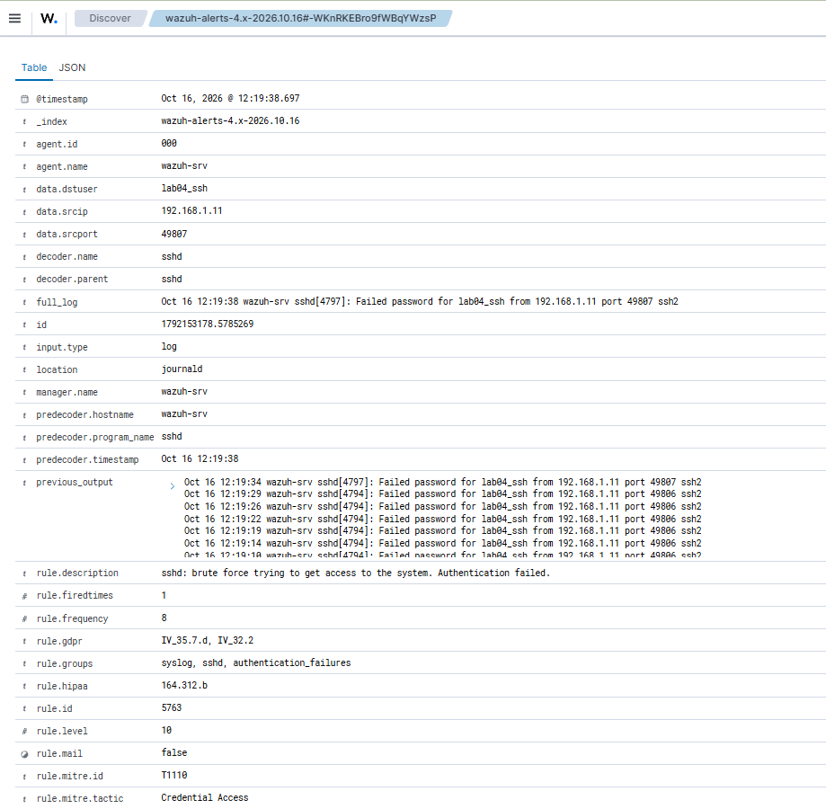
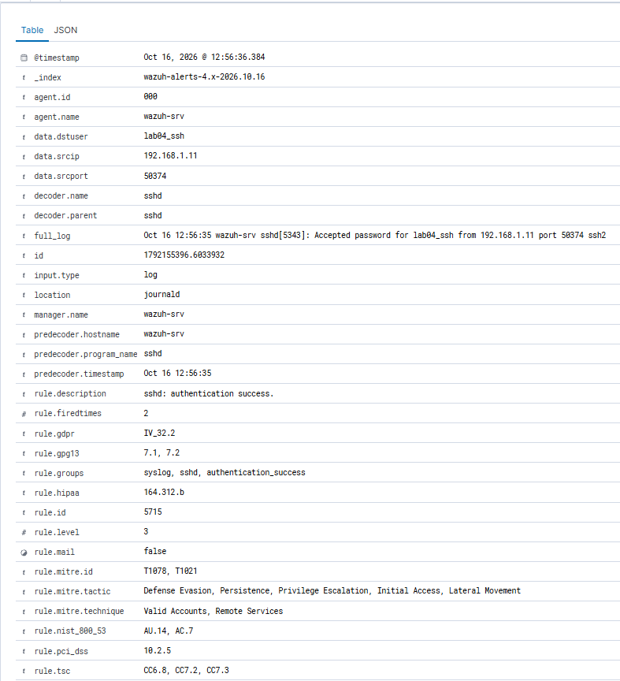

# LAB-04 — SSH Brute Force

## Общие сведения

**Статус:** Завершён.

В разрешённой лабораторной среде проверено обнаружение подбора SSH-пароля пользователя `lab04_ssh` с Kali Linux (`192.168.1.11`) к Ubuntu Server (`192.168.1.20`). Hydra сообщила о 12 попытках и отсутствии найденного пароля. На Ubuntu зарегистрированы 14 записей `Failed password`, в Wazuh — 23 оповещения, включая корреляционное правило `5763`, Level 10.

Цель анализа — сопоставить вывод Hydra, SSH-журнал и оповещения SIEM, проверить обнаружение серии ошибок и отделить её от последующих контрольных входов. Успешный подбор пароля в этом тесте не подтверждён.

**Вердикт:** True Positive — Authorized Simulation. **Критичность:** Low — с учётом санкционированного лабораторного контекста.

## Лабораторная среда

```text
Kali Linux (192.168.1.11)
  → OpenSSH / Ubuntu Server (192.168.1.20)
  → Journald → Wazuh SIEM на том же Ubuntu Server
```

| Компонент | Роль | Подтверждение |
| --- | --- | --- |
| Kali Linux, `192.168.1.11` | Источник симуляции; THC Hydra 9.7 и ручной SSH-вход | Адрес источника в SSH-событиях; версия в выводе Hydra |
| Ubuntu Server, `192.168.1.20`, `wazuh-srv` | Целевой OpenSSH Server и Wazuh Manager | Цель `ssh://192.168.1.20:22/` в выводе Hydra, имя хоста в событиях |
| `lab04_ssh` | Тестовая учётная запись | `dstuser` и исходные SSH/PAM-сообщения |
| Journald | Источник событий для Wazuh | `location: journald` во всех 26 приложенных JSON-записях |

## Моделирование атаки

Для теста подготовлены отдельный пользователь `lab04_ssh` и словарь из 12 заведомо неправильных паролей. Hydra запускалась с одним параллельным заданием на SSH-порт 22:

```text
[DATA] max 1 task per 1 server, overall 1 task, 12 login tries (l:1/p:12), ~12 tries per task
[DATA] attacking ssh://192.168.1.20:22/
1 of 1 target completed, 0 valid password found
```

В [выводе Hydra](evidence/04-hydra-output.txt) перечислены 12 строк `ATTEMPT`. Значения `LAB04_incorrect_01`–`LAB04_incorrect_12` — неправильные тестовые кандидаты, правильный пароль в материалах не опубликован. После теста выполнены отдельные ручные входы с правильным паролем — это контроль успешной аутентификации, а не результат подбора.

## Анализ обнаружения

### Оповещения Wazuh

[02-wazuh-alerts.jsonl](evidence/02-wazuh-alerts.jsonl) содержит **23 записи** за период подбора пароля:

| Rule ID | Level | Количество | Значение в данном кейсе |
| --- | --- | --- | --- |
| `5760` | 5 | 13 | `sshd: authentication failed.` — отдельные записи `Failed password` |
| `5763` | 10 | 1 | Корреляционное обнаружение серии неудачных SSH-аутентификаций |
| `5503` | 5 | 3 | `PAM: User login failed.` — сообщения `pam_unix(sshd:auth): authentication failure` |
| `5758` | 8 | 2 | `Maximum authentication attempts exceeded.` — превышение лимита попыток в соединении |
| `2502` | 10 | 2 | `syslog: User missed the password more than one time` — сообщения `PAM 5 more authentication failures` |
| `2501` | 5 | 2 | `syslog: User authentication failure.` — отключения с `Too many authentication failures` |
| **Всего** | — | **23** | Несколько типов сообщений об одной серии активности |

Hydra сообщила о 12 попытках входа, SSH-журнал Ubuntu содержит 14 ошибок аутентификации, а Wazuh сформировал 23 оповещения по разным правилам. Количество оповещений не соответствует количеству отдельных попыток входа. Причина расхождения между данными Hydra и SSH-журналом не установлена.

### Корреляционное правило 5763

| Поле | Значение из JSON |
| --- | --- |
| `rule.id` / `rule.level` | `5763` / `10` |
| `rule.description` | `sshd: brute force trying to get access to the system. Authentication failed.` |
| `rule.frequency` | `8` |
| `timestamp` | `2026-10-16T12:19:38.697+0000` |
| `data.srcip` / `data.dstuser` | `192.168.1.11` / `lab04_ssh` |
| `data.srcport` | `49807` |
| `rule.mitre.id` / tactic | `T1110` / Credential Access |

Поле `previous_output` содержит семь предыдущих `Failed password` в 12:19:10, 14, 19, 22, 26, 29 и 34 UTC, текущее событие относится к 12:19:38 UTC. Итого восемь ошибок одного источника за 28 секунд, что соответствует порогу `rule.frequency: 8`.



## Хронология событий

Дата событий — 16.10.2026.

| Время (UTC) | Событие и источник |
| --- | --- |
| 12:19:07 | Начало доступной выборки: preauth disconnect и PAM authentication failure; файлы 01–02 |
| 12:19:10 | Первый `Failed password`, PID `4794`, port `49806`, Rule `5760` |
| 12:19:31 | Лимит попыток, отключение и сводка PAM; Rules `5758`, `2501`, `2502` |
| 12:19:38 | Восьмой `Failed password` в выборке; Rule `5763`, Level 10 |
| 12:19:56 | Повторное превышение лимита, PID `4797`; Rules `5758`, `2501`, `2502` |
| 12:20:03 | Последний `Failed password`, PID `4800`, port `49809` |
| 12:20:04 | Закрытие соединения и `PAM 1 more authentication failure` в файле 01; конец наблюдаемой серии |
| 12:56:35 | Контрольный вход: `Accepted password` и `session opened`, Rules `5715` и `5501` |
| 12:56:36 | `session closed`, Rule `5502` |

## Анализ успешной аутентификации

В [03-ssh-success.jsonl](evidence/03-ssh-success.jsonl) сохранены три оповещения контрольного ручного входа:

| Rule ID | Level | Время исходного события (UTC) | Подтверждение |
| --- | --- | --- | --- |
| `5715` | 3 | 12:56:35 | `Accepted password for lab04_ssh from 192.168.1.11 port 50374 ssh2` |
| `5501` | 3 | 12:56:35 | Открыта PAM-сессия `lab04_ssh`, UID `1001` |
| `5502` | 3 | 12:56:36 | PAM-сессия `lab04_ssh` закрыта |



Успешные SSH-входы выполнялись вручную в рамках отдельной контрольной проверки и не были результатом успешного подбора пароля Hydra: Hydra сообщила `0 valid password found`, а в журналах периода подбора нет `Accepted password`.

## Сопоставление с MITRE ATT&CK

| Основание | Техника | Интерпретация |
| --- | --- | --- |
| Правило `5763` | T1110 — Brute Force, Credential Access | Классификация корреляционного оповещения Wazuh |
| Действия в сценарии | [T1110.001 — Password Guessing](https://attack.mitre.org/techniques/T1110/001/), Credential Access | Перебор кандидатов пароля одной SSH-учётной записи |
| Правила `5501` и `5715` | T1078; у `5715` также T1021 | Метаданные успешной аутентификации, не доказательство злоупотребления Valid Accounts или Lateral Movement |

Основная техника соответствует симулированному Password Guessing. Контрольный ручной вход не классифицируется как компрометация, закрепление или перемещение злоумышленника.

## Вердикт

**Вердикт:** True Positive — Authorized Simulation.

**Критичность:** Low.

Wazuh обнаружил фактически выполненную серию неудачных SSH-аутентификаций одного пользователя с одного IP. Это подтверждают `Failed password`, повторные ошибки PAM, превышение лимита и `previous_output` корреляционного оповещения. Санкционированный характер не делает сигнал False Positive: обнаруживаемая активность действительно произошла.

Критичность учитывает согласованный источник, тестовую учётную запись и отсутствие успешного подбора. Level 10 у `5763` — уровень правила SIEM, а не итоговая критичность. Вне известного тестового контекста аналогичная серия потребовала бы проверки разрешённости и эскалации. Выполнение вредоносных команд, эксфильтрация и другие последствия по этим данным не установлены.

## Рекомендации

- **Аутентификация по SSH-ключам.** Использовать ключи вместо паролей там, где это допускается политикой безопасности.
- **Ограничение доступа.** Разрешать SSH-подключения только из доверенных сетей или через VPN.
- **Защита от подбора паролей.** Использовать Fail2ban или аналогичные механизмы для ограничения повторных неудачных попыток входа.
- **Мониторинг.** Отслеживать серии неудачных SSH-аутентификаций и проверять последующие успешные входы.

## Исходные материалы

| Файл | Что подтверждает |
| --- | --- |
| [01-ssh-auth.log](evidence/01-ssh-auth.log) | 29 серверных строк за 12:19:07–12:20:04 UTC, включая 14 `Failed password`, сообщения PAM и отключения |
| [02-wazuh-alerts.jsonl](evidence/02-wazuh-alerts.jsonl) | 23 оповещения периода подбора, Rule `5763` с `previous_output`, уровни и поля корреляции |
| [03-ssh-success.jsonl](evidence/03-ssh-success.jsonl) | Три оповещения контрольного успешного входа: `5501`, `5715`, `5502` |
| [04-hydra-output.txt](evidence/04-hydra-output.txt) | Hydra 9.7, один пользователь, 12 кандидатов, один task, отсутствие найденного пароля |
| [01-wazuh-ssh-bruteforce-alert.png](screenshots/01-wazuh-ssh-bruteforce-alert.png) | Отображение Rule `5763`, Level 10 и основных полей в Wazuh Dashboard |
| [02-wazuh-ssh-success.png](screenshots/02-wazuh-ssh-success.png) | Отображение Rule `5715` и `Accepted password` |
